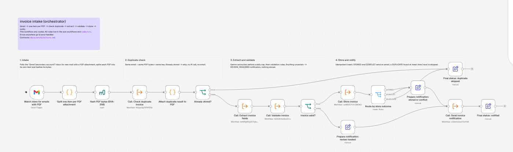
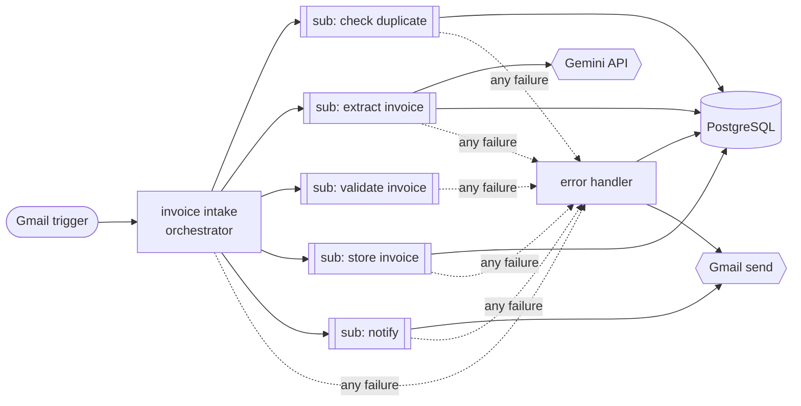
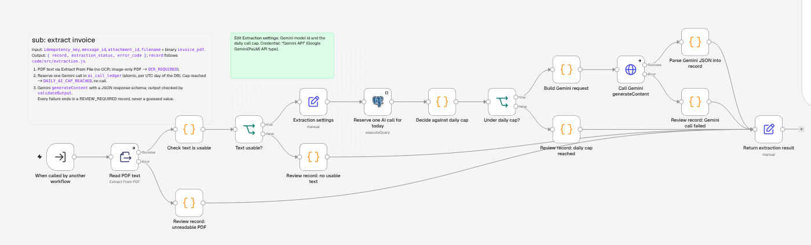
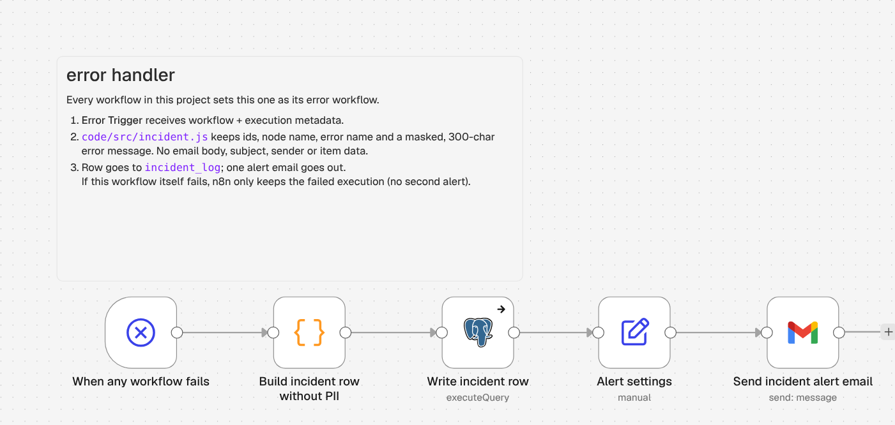

# Invoice intake automation on n8n

An n8n automation that reads invoice PDFs from Gmail, extracts the fields with Gemini, validates them, stores them in PostgreSQL without duplicates, and sends a notification email.

**Status:** built and tested locally with synthetic fixtures. Not yet run against live Gmail or Gemini (that needs the owner's credentials). Not a client deployment. Details in [Status](#status).

Author: Lam-Nguyen Nguyen. CV: https://cv.lnit.id.vn



## Tóm tắt (Tiếng Việt)

- Đây là một automation trên n8n: nhận email có hóa đơn PDF qua Gmail, trích xuất thông tin bằng Gemini, kiểm tra, lưu vào PostgreSQL (không lưu trùng), rồi gửi email thông báo. Email trùng được bỏ qua; mọi lỗi được ghi vào bảng sự cố và gửi cảnh báo.
- Cấu trúc: một workflow điều phối (`invoice intake`), 5 sub-workflow (kiểm tra trùng, trích xuất, kiểm tra hợp lệ, lưu, thông báo) và một workflow xử lý lỗi. Các luật nghiệp vụ nằm trong `code/` (JavaScript thuần, có test) và được nhúng vào các node Code.
- Trạng thái: đã xây và kiểm thử cục bộ bằng dữ liệu giả (42 test code, 28 test công cụ, chạy thử trên n8n 2.49.8 và Postgres thật). Chưa chạy với Gmail và Gemini thật vì cần thông tin đăng nhập của chủ dự án. Chưa triển khai cho khách hàng.
- Mã được viết bằng công cụ AI (Claude, Codex) theo thiết kế và yêu cầu của tác giả; tác giả và các agent kiểm tra độc lập rà soát và kiểm thử. Giai đoạn trước (thư viện Python) được giữ trong `docs/history/` và `legacy/`.

## What it does

1. A new email with a PDF attachment arrives in a Gmail inbox. Each PDF becomes one item and its bytes are hashed.
2. If the same email and the same PDF were already stored, the item is skipped (no AI call, no second notification).
3. The PDF text is sent to Gemini, which returns the invoice fields in a fixed JSON schema. A daily cap limits the number of Gemini calls.
4. The fields are validated (required fields, amount, currency, confidence, thresholds). Anything uncertain, unreadable or image-only is marked `REVIEW_REQUIRED` and is not stored.
5. Valid invoices are inserted into PostgreSQL once per idempotency key. A same-key row with different content is reported as a conflict; the first row is kept.
6. An email reports the outcome (stored, conflict, or needs review).
7. Any failure in any workflow writes a row without personal data to `incident_log` and sends one alert email.

## Architecture



The orchestrator only routes; each sub-workflow has one responsibility, declared typed inputs and a fixed output shape. The full flow, contracts, stored data and known limits are in [docs/architecture.md](docs/architecture.md).

| Workflow | Responsibility | Input | Output |
| --- | --- | --- | --- |
| [`invoice intake`](workflows/invoice-intake/README.md) | Read Gmail, split one item per PDF, hash, call the sub-workflows, route by result | New email with PDF attachment(s) | Final status per PDF: `DUPLICATE_SKIPPED` or `NOTIFIED` |
| [`sub: check duplicate`](workflows/sub/check-duplicate/README.md) | Look up the idempotency key | `message_id`, `attachment_sha256` | `{ idempotency_key, is_duplicate, existing_invoice_id }` |
| [`sub: extract invoice`](workflows/sub/extract-invoice/README.md) | PDF text, reserve a Gemini call under the daily cap, call Gemini, parse | key, message and attachment ids, filename, PDF binary | `{ record, extraction_status, error_code }` |
| [`sub: validate invoice`](workflows/sub/validate-invoice/README.md) | Apply the validation rules | `invoice` object | `{ valid, status, invoice, issues }` |
| [`sub: store invoice`](workflows/sub/store-invoice/README.md) | Idempotent insert, compare fingerprint | key, ids, filename, `invoice` | `{ outcome: STORED / DUPLICATE / CONFLICT, invoice_id, reason }` |
| [`sub: notify`](workflows/sub/notify/README.md) | Compose and send the outcome email | status, invoice fields, issue codes | `{ notified, channel, provider_message_id }` |
| [`error handler`](workflows/error-handler/README.md) | Write a masked `incident_log` row, send an alert | n8n error trigger data | incident row + one alert email |

| Canvas: `sub: extract invoice` | Canvas: `error handler` |
| --- | --- |
|  |  |

## Reliability features and how each is verified

| Feature | Verified by |
| --- | --- |
| Idempotent store: key = `sha256(message_id + PDF sha256)`, `INSERT .. ON CONFLICT DO NOTHING`, fingerprint compare (STORED / DUPLICATE / CONFLICT) | Unit tests in `code/test/`; smoke run on n8n 2.49.8 + Postgres: one key gave STORED, DUPLICATE, CONFLICT and one row |
| Duplicate email skipped before any AI call | Smoke run of an orchestrator copy with Gmail replaced by a fixture: duplicate email gave `DUPLICATE_SKIPPED` |
| Daily Gemini call cap, reserved atomically in Postgres | Unit tests; smoke run with the ledger seeded at the limit: `DAILY_AI_CAP_REACHED`, ledger unchanged; SQL reservation run directly with limit 2 (1, 2, then no row) |
| Unreadable input never stored: image-only PDF, corrupt PDF, uncertain fields go to `REVIEW_REQUIRED` | Unit tests; smoke runs gave `OCR_REQUIRED` and `UNREADABLE_PDF` |
| Failures logged without personal data and alerted | Unit tests of masking; smoke run of an error handler copy wrote an incident row with e-mail address and digit runs masked |
| Workflows stable in git | `scripts/n8n-normalize.js --check`, `n8n-lint.js`, `n8n-docs.js --check`; round trip import/export on n8n 2.49.8 gave identical files (recorded in the tooling report) |

Counts re-run on 2026-11-27: `cd code && node --test` 42 tests, 42 pass; `node --test scripts/test/*.test.js` 28 tests, 28 pass; lint, normalize check and docs check pass on 7 workflow files. CI runs the same static checks plus the round trip (`.github/workflows/n8n-checks.yml`). Gmail read/send and Gemini were replaced in the smoke runs, so none of the rows above covers those calls.

## Status

- Built and tested locally with synthetic fixtures (`tests/fixtures/`) on a throwaway n8n 2.49.8 and Postgres.
- **Not yet run against live Gmail or Gemini.** That needs the owner's credentials. The Gemini request schema, model id (`gemini-2.5-flash`) and response parsing are tested only against fixtures; the `STORED` path through the whole orchestrator has not run because it needs a real Gemini answer.
- Not a client deployment and not used in production.
- Open limits (full list in [architecture.md](docs/architecture.md#known-limits)): if Gmail send fails after a successful store, a re-run skips the notification (L1); PDFs beyond 100 pages are truncated without a review flag; the call cap counts attempts, not money.
- The PDF text goes to Gemini. Check Google's API terms and data region before using real invoices.

## Run it in 10 minutes

Needs Docker with Compose v2 and Node.js 22+ for the scripts.

```bash
cp .env.example .env        # set POSTGRES_PASSWORD (URL-safe) and N8N_ENCRYPTION_KEY (>= 32 chars)
docker compose up -d        # n8n 2.49.8 on http://127.0.0.1:5678, Postgres with the schema
```

1. Open http://127.0.0.1:5678 and create the owner account.
2. Create three credentials with exactly these names (details in [docs/run-guide.md](docs/run-guide.md)): `Postgres (local)`, `Gemini API`, `Gmail (secondary account)`.
3. Import: `node scripts/n8n-import.js --docker "$(docker compose ps -q n8n)"`. It reports `expected 7, found on target 7`.
4. Publish in this order: the five `sub:` workflows and `error handler` first, then `invoice intake`. Set real recipients in the **Notification settings** and **Alert settings** nodes first (they hold `example.invalid`).

Back up `N8N_ENCRYPTION_KEY`. Steps 2 and 4 use real accounts and were not executed against live services (see Status).

## Edit a workflow and save it to git

1. Edit in the n8n editor (or change `code/src/*.js` and run `node code/tools/build-workflows.js`).
2. Export: `node scripts/n8n-export.js --docker "$(docker compose ps -q n8n)"` (writes normalized `workflows/**/workflow.json`; credentials are never exported).
3. Regenerate docs: `node scripts/n8n-docs.js`.
4. Check: `node scripts/n8n-lint.js && node scripts/n8n-normalize.js --check && node --test scripts/test/*.test.js && (cd code && node --test)`.
5. Review the diff and commit. Note: the generator overwrites UI edits of generated workflows on its next run, so port UI changes into `code/tools/build-workflows.js`. See [docs/tooling.md](docs/tooling.md).

## Repository layout

| Path | Content |
| --- | --- |
| `workflows/` | n8n workflows as normalized JSON + generated README per workflow |
| `code/` | Business rules as plain JavaScript (`src/`), `node:test` tests (`test/`), workflow generator and smoke harness (`tools/`) |
| `scripts/` | n8n export / import / normalize / docs / lint scripts and their tests |
| `infra/` | `docker-compose.yml` (pinned n8n + Postgres), `postgres/` init SQL |
| `tests/fixtures/` | Synthetic emails and PDFs |
| `docs/` | [architecture](docs/architecture.md), [tooling](docs/tooling.md), [run guide](docs/run-guide.md), [incident runbook](docs/runbooks/incidents.md), [images](docs/images/) |
| `docs/history/`, `legacy/`, `examples/` | Earlier phases, see below |
| `AGENTS.md` | Rules for AI coding agents (`CLAUDE.md` and `GEMINI.md` point to it) |

## History

The repository started as a Python module library with a FastAPI layer. That code is in [`legacy/python-modules/`](legacy/python-modules/) (still runnable, no new features), its documents in [docs/history/](docs/history/README.md), and the never-run lead-management workflows in [`examples/lead-management/`](examples/lead-management/).

## How it was built

Designed and directed by Lam-Nguyen Nguyen. The code was written with the AI coding agents Claude and Codex. He reviewed and tested it, and independent agent reviews checked it.

Contact: https://cv.lnit.id.vn
