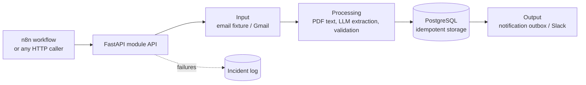

# Workflow Automation Modules

Reusable building blocks for workflow automation (n8n first, plain Python/HTTP also supported), with a reference "Intelligent Document Intake" workflow: read an email with a PDF invoice, extract the fields, validate them, store them in PostgreSQL, and prepare a notification.

**Status:** portfolio system, built and tested locally with synthetic data. Not a client deployment, not used in production. No live Gmail, OpenAI, Slack, CRM or Google Forms call has been made (see "Not yet done").

Author: Lam-Nguyen Nguyen. CV: https://cv.lnit.id.vn

## Tóm tắt (Tiếng Việt)

- Bộ module tự động hóa quy trình làm việc (workflow), ưu tiên n8n: nhận email có hóa đơn PDF, đọc và trích xuất thông tin, kiểm tra, lưu vào cơ sở dữ liệu PostgreSQL, rồi tạo thông báo.
- Đây là hệ thống mẫu để làm portfolio, chạy trên máy cá nhân với dữ liệu giả. Chưa triển khai cho khách hàng, chưa chạy production, chưa gọi dịch vụ thật (Gmail, OpenAI, Slack, CRM).
- Hiện có: API chạy được ở chế độ thử (DRY_RUN) không cần khóa dịch vụ nào, 198 bài test tự động đạt (chạy lại ngày 27/11/2026), mẫu workflow n8n để nhập vào.
- Mã được viết bằng công cụ AI (Claude, Codex) theo thiết kế và yêu cầu của tác giả, sau đó tác giả và các agent kiểm tra độc lập rà soát và kiểm thử.

## What problem it solves

- Small teams receive documents (invoices, forms) by email or form and copy data by hand. The reference workflow shows how to automate that path.
- Automations often fail quietly: duplicate runs, double writes, retries that send twice. Each module here documents its duplicate handling, retry and failure behavior, and the tests cover those cases.
- When you only have the workflow nodes and no access to the client's system, debugging is hard. Modules return sanitized, bounded diagnostics, and failed runs go into an incident log with no raw personal data.

## What works today and what does not

Verified from code, tests and docs in this repo. Test status below was re-run on 2026-11-27 unless noted.

### Works today (synthetic data, local)

- Full document-intake graph in `DRY_RUN` mode: email fixture -> PDF text -> field extraction -> validation -> storage preview -> notification preview. Re-checked: the API returned `SUCCESS` for all steps with no credentials.
- Unit test suite: `uv run --extra dev pytest -q` gives **198 passed** (about 2 seconds).
- Module API with catalog, per-module and per-workflow run routes, execution modes `DRY_RUN`, `REPLAY`, `MOCK`, `REAL`.
- PostgreSQL storage with idempotency keys (duplicate and changed-payload handling), a notification outbox, a source-poll lease/checkpoint, an incident log, and ledgers for CRM and LLM calls. Evidence: 10 Docker Compose + PostgreSQL integration scripts in `tests/integration/` (recorded as passing in `docs/project-state/verification.md`; **not re-run for this README**).
- n8n starter workflow `workflows/n8n/intelligent-document-intake.demo.json` (six HTTP nodes calling the API in `DRY_RUN`). A separate lead-management preview workflow was imported and run once in a local n8n (recorded in the project-state docs; not re-run here).
- Reusable adapter modules with mocked-HTTP tests: HighLevel (GHL) contact upsert, opportunity upsert, contact tags; Gmail send; lead intake, qualification and follow-up gate.

### Not yet done / not verified

- No live provider call has been made: Gmail read/send, OpenAI extraction or qualification, Slack, HighLevel CRM, Google Forms API. Adapters are tested against mocks only.
- The Google Forms API poller n8n workflow is imported but inactive; OAuth is not granted and it has never run.
- The lead-management brief is only partly built. The graph ends at PostgreSQL storage; CRM and follow-up modules exist but are not wired into it.
- Safety limits are partial: the LLM cap counts requests per day, not money; there is no external alerting, retry scheduler or retention job.
- The API uses one shared bearer key, not per-user login. Keep it on loopback/private network. Do not use with client documents before reviewing n8n data retention and access.
- The n8n JSON files are starter templates; they must be validated against the exact n8n version used for a real job.
- No real client data, no client deployment, no production use.

The authoritative record is in [project state](docs/project-state/README.md) (intent, decisions, implementation, verification). A proposal is never counted as implemented there.

## Architecture



Stages are input, processing, storage and output. Cross-cutting concerns (idempotency, retry, concurrency, security, recovery, observability) are documented per module. Contracts are platform-neutral so n8n can be replaced.

## Quick start

Needs Python 3.12+ and `uv`. No provider credentials are needed for the dry run.

```
uv sync --extra dev
uv run pytest -q
uv run uvicorn workflow_automation.api:app --app-dir src --host 127.0.0.1 --port 8000
```

In another terminal (the repo documents the PowerShell form; this is the same call with curl):

```
curl -X POST http://127.0.0.1:8000/v1/workflows/intelligent_document_intake/runs -H "Content-Type: application/json" -d "{}"
```

`/healthz` checks the process and `/v1/catalog` lists modules and workflows. For the PostgreSQL + n8n Docker Compose stack (copy `.env.example` to `.env`, set local secrets, `docker compose up --build`), the PowerShell call, execution modes and the lead-management reference, see the [run guide](docs/run-guide.md).

## Repository layout

```
src/workflow_automation/   framework core, API, modules (input, processing, storage, output, crm), PostgreSQL infrastructure
tests/                     unit tests and Docker/PostgreSQL integration scripts
workflows/n8n/             importable n8n workflow templates
fixtures/                  synthetic emails and PDFs
infra/postgres/            database initialisation
docs/                      plan, module contracts, per-module guarantees, runbooks, release notes, project state
Dockerfile, docker-compose.yml, .env.example
```

Key docs: [run guide](docs/run-guide.md), [project plan](docs/plan.md), [module contract](docs/module-contract.md), [module quality template](docs/module-quality-template.md), [portfolio module guarantees](docs/modules/portfolio-modules.md), [lead-management reference](docs/modules/lead-management-reference.md), [runbooks](docs/runbooks/workflow-incidents.md), [releases](docs/releases/0.14.0.md) (0.1.0 to 0.14.0 in `docs/releases/`).

## How it was built

Designed and directed by Lam-Nguyen Nguyen; code written with AI coding agents (Claude, Codex) under his specifications, then reviewed and tested by him and independent agent reviews (audit records are in `docs/project-state/`).

## Contact

CV and contact: https://cv.lnit.id.vn
