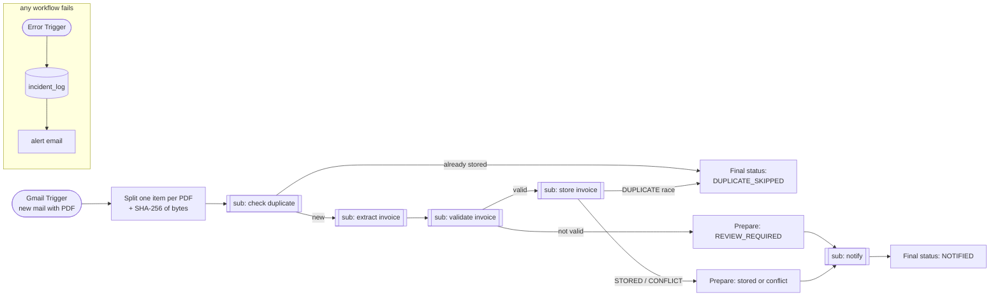

# Architecture: invoice intake on n8n

The product is a set of n8n workflows. An orchestrator reads Gmail and calls one
sub-workflow per step; each sub-workflow does one thing and has a fixed input and output.
The rules (validation, normalization, duplicate key, AI-call cap) are plain JavaScript in
`code/src/`, unit-tested with `node:test`, and embedded into the n8n Code nodes by
`code/tools/build-workflows.js`. Python is no longer in the runtime flow
(`legacy/python-modules/`).

Status: built and smoke-tested on a local throwaway n8n 2.49.8 and Postgres 16 with
synthetic fixtures. No call to Gmail or Gemini has been made (see "Mocked vs real").

## Flow



| Workflow | File | Calls |
| --- | --- | --- |
| `invoice intake` (orchestrator) | `workflows/invoice-intake/workflow.json` | all five sub-workflows |
| `sub: check duplicate` | `workflows/sub/check-duplicate/workflow.json` | Postgres (read) |
| `sub: extract invoice` | `workflows/sub/extract-invoice/workflow.json` | Postgres (`ai_call_ledger`), Gemini REST |
| `sub: validate invoice` | `workflows/sub/validate-invoice/workflow.json` | nothing |
| `sub: store invoice` | `workflows/sub/store-invoice/workflow.json` | Postgres (`invoices`) |
| `sub: notify` | `workflows/sub/notify/workflow.json` | Gmail send |
| `error handler` | `workflows/error-handler/workflow.json` | Postgres (`incident_log`), Gmail send |

Every workflow except `error handler` sets `settings.errorWorkflow` to `@workflow:error handler`.
Sub-workflow references are by name (`@workflow:<name>`); `scripts/n8n-import.js` maps names
to ids. `callerPolicy` is `workflowsFromSameOwner`: a list of caller ids would hold
instance-specific ids that do not survive normalization.

The orchestrator holds no rules. Its two Code nodes are plumbing: split binaries into one
item per PDF, and put the PDF binary back after a sub-workflow call (sub-workflow outputs
replace the item; the Crypto node also drops the binary).

## Sub-workflow contracts

All sub-workflows use an Execute Sub-workflow Trigger with declared inputs ("Define using
fields below") and are called once per item (`mode: each`).

| Sub-workflow | Inputs (type) | Output (always this shape) |
| --- | --- | --- |
| check duplicate | `message_id` (string), `attachment_sha256` (string, 64 hex) | `{ idempotency_key, is_duplicate, existing_invoice_id }` |
| extract invoice | `idempotency_key`, `message_id`, `attachment_id`, `filename` (string) + binary `invoice_pdf` | `{ record, extraction_status: EXTRACTED\|REVIEW_REQUIRED, error_code }` |
| validate invoice | `invoice` (object = `record` above) | `{ valid, status: VALID\|REVIEW_REQUIRED, invoice, issues: [{code, field}] }` |
| store invoice | `idempotency_key`, `message_id`, `attachment_id`, `filename` (string), `invoice` (object) | `{ outcome: STORED\|DUPLICATE\|CONFLICT, invoice_id, reason }` |
| notify | `status`, `invoice_number`, `sender`, `amount`, `currency`, `invoice_id`, `filename` (string), `issues` (array of codes) | `{ notified, channel: "gmail", provider_message_id }` |

`error_code` values from extract invoice: `OCR_REQUIRED` (no selectable text),
`TEXT_LIMIT_EXCEEDED` (> 500 000 chars), `UNREADABLE_PDF` (encrypted or malformed),
`DAILY_AI_CAP_REACHED`, `AI_LEDGER_UNREADABLE`, `PROVIDER_REQUEST_FAILED` (HTTP error),
`INVALID_STRUCTURED_OUTPUT`, `PROVIDER_UNAVAILABLE`, `PROVIDER_REJECTED_REQUEST`.
Any of these gives a record with `status: REVIEW_REQUIRED`, all invoice fields null, which
validation always rejects, so nothing uncertain is stored.

Duplicate key (`code/src/duplicate-key.js`): `sha256(message_id + "\n" + sha256(PDF bytes))`.
The same email polled twice gives the same key; the same PDF in a new email is a new invoice.

Store (`code/src/store-outcome.js` + one SQL statement): `INSERT ... ON CONFLICT
(idempotency_key) DO NOTHING`, then the existing row's `payload_fingerprint` is compared.
Same fingerprint = `DUPLICATE`, different = `CONFLICT` (first row kept, never overwritten).
If the row cannot be read in the same statement (a concurrent insert committed after the
statement snapshot), the node throws; the error handler records it and a re-run is safe.

AI-call cap: before every Gemini call, `INSERT INTO ai_call_ledger ... ON CONFLICT DO UPDATE
SET calls = calls + 1 WHERE calls < limit RETURNING calls` reserves one call atomically. No
row back = cap reached, no call. The limit (default 50) and the model id
(default `gemini-2.5-flash`, not checked against Google's current list) are in the
**Extraction settings** node. It counts attempts per database day, not tokens or money.

## Error path

`error handler`: Error Trigger -> `code/src/incident.js` builds a row with workflow id/name,
execution id, failed node, error class and the error message masked (e-mail addresses and
digit runs of 6+ replaced) and cut to 300 chars. No email body, subject, sender, attachment
or item data. -> insert into `incident_log` (failure here does not stop the alert) -> one
plain-text alert email. If the error handler itself fails, n8n only keeps that execution.

Execution data: `saveDataSuccessExecution: none`, `saveDataErrorExecution: all`. Failed
executions therefore keep item data (which can include extracted invoice fields) in the n8n
database until n8n's pruning removes them. Set n8n pruning to match your retention policy.

## Data stored

Schema: `infra/postgres/10-invoice-intake.sql` (application database; n8n's own database is
created by `00-create-n8n-db.sql`).

| Table | Content | Not stored |
| --- | --- | --- |
| `invoices` | idempotency key (unique), Gmail message id, attachment key, filename, invoice number, sender, amount, currency, normalized JSON, fingerprint, n8n execution id | email body, subject, sender address, PDF bytes, PDF text |
| `ai_call_ledger` | (day, provider) -> number of reserved calls | prompts, responses |
| `incident_log` | ids, node name, error class, masked message, `acknowledged_at` | item data |

The PDF text is sent to Gemini (Google). Check the Gemini API terms and data region before
using real invoices.

## Mocked vs real

| Part | State |
| --- | --- |
| Gmail Trigger, Gmail send | Real n8n nodes, credential placeholder "Gmail (secondary account)". **Never run** against Gmail. In the smoke test they were replaced by a Code node and a No-Op node. |
| Gemini call | Real HTTP Request node to `generativelanguage.googleapis.com/v1beta/models/<model>:generateContent`, credential "Gemini API" (type `googlePalmApi`, key sent as `?key=`). **Never called.** The request schema and response parsing are unit-tested only. |
| PDF text, hashing, routing, Postgres writes, cap, incident row | Run for real in the smoke test (local n8n + local Postgres). |
| Credentials | Name placeholders only; on import n8n attaches credentials by name and type. |

## Ported rules (from the Python modules)

Kept as they were: every rule and code of `data.validate` (required fields, `UNSUPPORTED_FIELD`,
`EXTRACTION_REQUIRES_REVIEW`, amount/currency/confidence/source_ids checks, thresholds,
duplicate record keys, issue de-duplication); store normalization (stored field list,
`document_type` default `invoice`, `status` default `EXTRACTED`, amount as decimal text,
confidence 0..1); first-write-wins with fingerprint comparison; the extraction prompt, the
strict output schema and `_validate_output` (null fields always listed as missing, conflicting
fields nulled and sent to review); `OCR_REQUIRED` and the 500 000-char text limit.

Changed:

1. Duplicate key: was the tuple (source system, account, message id, attachment id); now
   `sha256(message id, PDF sha256)`. Two byte-identical PDFs in one email are now one invoice.
2. `record_key`: now `invoice:` + first 24 hex chars of the idempotency key.
3. Normalization: numeric strings like `"10.50"` are accepted (exponent forms like `"1e3"`
   are not); currency is trimmed and upper-cased instead of rejected when lowercase;
   `invoice_number` and `sender` are trimmed. Fingerprints are computed in JavaScript and are
   not byte-compatible with rows written by the Python store.
4. Amount and confidence must be JSON numbers (Python also took `Decimal`).
5. PDF handling is n8n's Extract From File: no 10 MB size check; pages beyond 100 are
   ignored instead of `PAGE_LIMIT_EXCEEDED`; encrypted and malformed PDFs share
   `UNREADABLE_PDF`; non-PDF attachments are skipped silently instead of
   `UNSUPPORTED_DOCUMENT_TYPE` / `MIME_TYPE_MISMATCH` review.
6. Provider: OpenAI Responses API -> Gemini `generateContent` with `responseSchema`. HTTP
   errors give `PROVIDER_REQUEST_FAILED` without the old timeout/429/5xx split, and there is
   no automatic retry. The deterministic local parser used in Python `DRY_RUN` is not ported.
7. Notification: the Python durable outbox (claim, states, redaction) is replaced by a
   direct Gmail send. See limit L1.

## Known limits

- L1: if Gmail send fails after a successful store, the error handler alerts, but re-running
  the execution finds the invoice as a duplicate and skips the notification.
- L2: the cap counts reserved attempts; a failed Gemini call still uses one.
- L3: `current_date` of the database decides the day; set the server TimeZone deliberately.
- L4: the Gmail Trigger polls every minute and only sees mail after the workflow is
  published; mail that arrived while it was unpublished is not backfilled.
- L5: sub-workflows must be **published** before the orchestrator can call them
  (n8n 2.x: "Workflow is not active and cannot be executed"); publishing needs the
  referenced credentials to exist.

## Changing a workflow

Edit `code/tools/build-workflows.js` (structure) or `code/src/*.js` (rules), then:

```bash
node code/tools/build-workflows.js        # writes normalized workflows/**/workflow.json
node scripts/n8n-docs.js                  # refresh per-workflow README.md
cd code && node --test                    # unit tests + drift check against the generator
```

Editing in the n8n UI and exporting with `scripts/n8n-export.js` also works, but the next
generator run overwrites those edits; port them into the generator.

## How this was verified (2026-11-27)

- `cd code && node --test`: unit tests for every module plus structural checks of the
  workflow files (node types/versions present in n8n 2.49.8, no default names, inputs of
  every call match the sub-workflow's declared inputs, credentials name-only).
- `scripts/n8n-lint.js`, `scripts/n8n-normalize.js --check`, `scripts/n8n-docs.js --check`
  from the tooling branch: no problems.
- Throwaway n8n 2.49.8 (Node 24, SQLite) + throwaway Postgres 16 with the schema:
  `scripts/n8n-import.js` imported 7/7 workflows, credentials attached by name; the sub-
  workflows were published; `code/tools/smoke-harness.js` workflows were run with
  `n8n execute`: validate (valid / below minimum / review), store (STORED, DUPLICATE,
  CONFLICT on one key), check duplicate (stored key true, unknown key false), extract
  (text PDF -> cap reached with the ledger seeded at 50, image-only PDF -> `OCR_REQUIRED`,
  corrupt PDF -> `UNREADABLE_PDF`; ledger stayed at 50), orchestrator copy with Gmail
  replaced (duplicate email skipped, new email -> review notification prepared), error
  handler copy (incident row written, e-mail and number masked).
- Not run: Gmail read/send, Gemini, the `STORED` path through the full orchestrator (needs a
  Gemini answer), n8n UI editing.
