# Lead-management status map

**Snapshot:** release 0.14.0, 2026-10-03. This is a visual map of the portfolio exercise based on test and runtime evidence, not a claim of customer deployment.

## What the colors mean

- **Green — locally verified:** exercised with fixtures/synthetic data and local Docker/PostgreSQL; says nothing about a live provider account.
- **Blue — adapter/module verified:** request mapping and failure paths pass unit/mocked HTTP tests; provider itself was not called.
- **Yellow — needs client setup or decision:** the module exists, but a client account/API, credential, billing approval, business rule, or live check is still required.
- **Red — missing or not composed:** no complete runnable path or operational capability is available yet.
- **Solid arrow:** this boundary has an executed local synthetic path. **Dotted arrow:** intended job path only; it is not wired and accepted end to end.

## Visual pipeline

```mermaid
flowchart LR
    LiveForm["Google Form<br/>private; empty; no API grant"] -. "not read; OAuth absent" .-> Poller["n8n Forms poller<br/>18 nodes; imported inactive"]
    Poller -. "OAuth + live response not verified" .-> Map["Forms response mapper<br/>question mapping + shape checks"]

    Fixture["Synthetic FormResponse / fixture"] --> Map
    Map --> Intake["Normalize + validate\nflag missing data"]
    Intake --> Store["PostgreSQL lead store<br/>event dedupe + payload conflict"]

    Store -. "not composed into this job graph" .-> Qualify["LLM qualification\nstructured output + event ledger"]
    Qualify -. "owner rubric + client API key" .-> GHL["GoHighLevel\ncontact + tags + opportunity"]
    GHL -. "no approved enrollment/events" .-> Gate["Follow-up suppression gate\nreply / booking / opt-out / pause"]
    Gate -. "no approved sender/content" .-> Email["Gmail sender + outbox\nacknowledgement / follow-up"]

    RunError["Workflow run failure"] --> Incidents["Local incident log<br/>list + acknowledge API"]
    Incidents -.-> Ops["External alert + DLQ + operator recovery<br/>not implemented as a complete path"]
    Email -.-> Acceptance["One enquiry end to end<br/>not yet demonstrated or accepted"]

    classDef local fill:#d9ead3,stroke:#38761d,color:#111;
    classDef adapter fill:#cfe2f3,stroke:#0b5394,color:#111;
    classDef waiting fill:#fff2cc,stroke:#bf9000,color:#111;
    classDef missing fill:#f4cccc,stroke:#990000,color:#111;
    class LiveForm,Poller,Gate waiting;
    class Qualify,GHL,Email adapter;
    class Fixture,Map,Intake,Store,RunError,Incidents local;
    class Ops,Acceptance missing;
```

The green path is local synthetic evidence. The Form poller, live LLM, CRM and sender are not connected to that tested path. The blue adapter evidence is detailed below; yellow means a module is present but client-side setup/live checks remain.

## Module and cost board

| Stage | What exists and what was verified | Client/job gate | Cost or quota to check |
|---|---|---|---|
| Form source | Forms API mapper and poll checkpoint; synthetic mapper/store and PostgreSQL checkpoint tests pass. n8n poller graph is imported, inactive and credential-free. | Select which Google account may grant the read-only scopes; create OAuth client/consent, connect the test Form, verify live question IDs and one synthetic response. | Standard Forms API use is currently no-additional-cost within quota; Google documents planned overage charges later in 2026. Check current quota/pricing. |
| Mapping and validation | Deterministic response mapping, normalization, required-field checks and review outcomes; independently tested with synthetic cases. | Confirm field titles/IDs and required fields against the client's source. | No external API fee in the mapper itself. Source account/hosting can still have its own cost. |
| PostgreSQL lead store | Local Compose PostgreSQL integration verifies first write, duplicate event and changed-payload conflict. | Client database/hosting, retention, backups and access policy for a real deployment. | Local software is self-hosted; cloud database, disk, compute and backups can cost money. |
| LLM qualification | Structured-output adapter, validation, event ledger, unknown-outcome hold and call-count limit; unit/mock evidence only. | Client supplies OpenAI API organization/key, approved rubric/data use/model and a USD spend limit. Live quality test happens only within client authorization. | OpenAI API is billed separately from ChatGPT Plus; current module cap counts calls, it does not cap dollars. |
| GHL contact, tags, opportunity | Contact and opportunity use stable event keys, cache confirmed results and hold unknown writes. PostgreSQL + mocked HTTP verifies replay, conflict and concurrency; tags have separate additive effect-guard tests. | Client supplies active HighLevel Location/token/scopes, duplicate policy, field/tag/pipeline/stage mappings and a test record. | Account subscription and optional workflows, AI or messaging may add plan/usage charges. Client checks the actual billing page before enabling them. |
| Follow-up state gate | PostgreSQL tests cover enrollment, terminal stops, pause/resume, concurrency and fail-closed database timeout. | Define consent/enrollment, approved text/cadence/booking link, and authoritative reply/booking/opt-out sources; connect the gate before each send. | The gate itself has no provider call. Sender, messaging product and hosting can have costs. |
| Gmail sender | Mock transport and local outbox tests cover duplicate/unknown send handling and redaction. One earlier self-addressed test email was sent through the connected Gmail app; the portfolio sender module was not used for that message. | Client authorizes mailbox/OAuth scope, recipient, content and test send. Standalone module does not refresh OAuth tokens itself. | Gmail API standard quota is currently no-additional-cost within thresholds; overage charges are planned later in 2026. Workspace/mailbox plan and quota still apply. |
| n8n and runtime | Local Docker API 0.14.0 and PostgreSQL are healthy; n8n 2.41.6 has a successful synthetic `DRY_RUN` preview. Forms workflow remains inactive. | For a job, use the client's supported n8n edition/version, credentials store, runtime URL and deployment/network/security setup. | n8n Cloud is subscription-based; self-hosting shifts cost to compute, storage, backups and maintenance. Check license/plan features. |
| Errors and operations | Local incident log records sanitized failures and supports an authenticated list/acknowledge API. | Choose alert destination/owner; build and test operator resolution/replay runbook against the client's systems. | Slack/email provider usage and hosting may have costs. |
| Full job flow | No complete Forms → qualification → GHL → follow-up run has been executed or accepted. | Client access, business rules, test data and acceptance matrix are required before composing it. | Total cost depends on client plan, volume, provider features and hosting; price after discovery, before activation. |

For current official references and account prerequisites, see [provider cost checklist](COSTS.md). No provider API usage or billable calls were made for this snapshot.

## What can happen before a client job

- Improve reusable adapters, contracts, validation, local integration tests, database migrations, setup docs and safe error handling without buying provider access.
- Improve offline debugging tools for exported workflow JSON, redacted execution data, request/response samples and synthetic replay.
- Keep live provider behavior, customer mappings, message policy, tenant-specific duplicate rules, OAuth scope approval and deployment choices for the job that supplies them.

## How a real debugging job enters this map

```mermaid
flowchart LR
    Brief["Job brief + expected vs actual"] --> Artifact["Exported workflow JSON\nredacted execution/error data"]
    Artifact --> Boundary["Identify failing node/API/DB boundary"]
    Boundary --> Repro["Reproduce with synthetic fixture\nor client test account"]
    Repro --> Patch["Fix existing module or add a reusable module"]
    Patch --> Verify["Replay success + duplicate + failure + recovery cases"]
    Verify --> Handover["Document setup, costs, limits, known risks"]
    Handover --> ClientCheck["Client verifies on their account\nwhen acceptance requires live behavior"]
```

To debug an inaccessible customer instance, an n8n export alone may show graph structure but not why a specific run failed. Ask for a redacted execution export, failing node input/output, exact provider status/body with secrets and personal data removed, expected outcome, workflow/version details and a safe way to exercise a client test account. Credentials should be entered through the customer's credential manager or another secure channel, never committed or pasted into this repository.

## Evidence links

- [Release 0.14.0 verification and known gaps](../verification.md#current-release-0140--cost-aware-module-readiness-and-ghl-event-ledgers)
- [Release notes](../../releases/0.14.0.md)
- [Capability contracts and job acceptance gates](PIPELINE.yaml)
- [Normalized job brief and unresolved owner decisions](JOB_SPEC.yaml)
