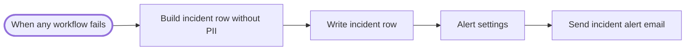

# error handler

<!-- n8n-docs:begin (generated by scripts/n8n-docs.js; do not edit between markers) -->

## Diagram

## Purpose

Error workflow: log a PII-free incident row and send one alert email.

## Trigger

- `When any workflow fails` (errorTrigger): runs when another workflow fails

## Inputs

_Not a sub-workflow entry point; see Trigger._

## Outputs

Data produced by the terminal node(s): `Send incident alert email`

## Error handling

- Error workflow: none declared (`settings.errorWorkflow` is empty).
- Nodes with custom error handling: `Write incident row` (continueRegularOutput)

## Nodes

| Node | Type | Credential |
| --- | --- | --- |
| Alert settings | set |  |
| Build incident row without PII | code |  |
| Send incident alert email | gmail | Gmail (secondary account) |
| When any workflow fails | errorTrigger |  |
| Write incident row | postgres | Postgres (local) |

<!-- n8n-docs:end -->

## Notes

<!-- Manual notes go here; they survive regeneration. -->
