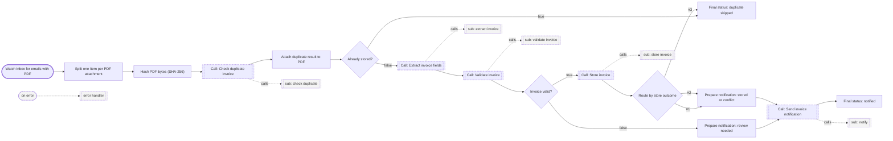

# invoice intake

<!-- n8n-docs:begin (generated by scripts/n8n-docs.js; do not edit between markers) -->

## Diagram

## Purpose

Orchestrator: Gmail trigger and sub-workflow calls only. No business rules here.

## Trigger

- `Watch inbox for emails with PDF` (gmailTrigger)

## Inputs

_Not a sub-workflow entry point; see Trigger._

## Outputs

Data produced by the terminal node(s): `Final status: duplicate skipped`, `Final status: notified`

## Error handling

- Error workflow: [error handler](../error-handler/README.md)

## Related workflows

Calls:

- `Call: Check duplicate invoice` -> [sub: check duplicate](../sub/check-duplicate/README.md)
- `Call: Extract invoice fields` -> [sub: extract invoice](../sub/extract-invoice/README.md)
- `Call: Send invoice notification` -> [sub: notify](../sub/notify/README.md)
- `Call: Store invoice` -> [sub: store invoice](../sub/store-invoice/README.md)
- `Call: Validate invoice` -> [sub: validate invoice](../sub/validate-invoice/README.md)

## Nodes

| Node | Type | Credential |
| --- | --- | --- |
| Already stored? | if |  |
| Attach duplicate result to PDF | code |  |
| Call: Check duplicate invoice | executeWorkflow |  |
| Call: Extract invoice fields | executeWorkflow |  |
| Call: Send invoice notification | executeWorkflow |  |
| Call: Store invoice | executeWorkflow |  |
| Call: Validate invoice | executeWorkflow |  |
| Final status: duplicate skipped | set |  |
| Final status: notified | set |  |
| Hash PDF bytes (SHA-256) | crypto |  |
| Invoice valid? | if |  |
| Prepare notification: review needed | set |  |
| Prepare notification: stored or conflict | set |  |
| Route by store outcome | switch |  |
| Split one item per PDF attachment | code |  |
| Watch inbox for emails with PDF | gmailTrigger | Gmail (secondary account) |

<!-- n8n-docs:end -->

## Notes

<!-- Manual notes go here; they survive regeneration. -->
