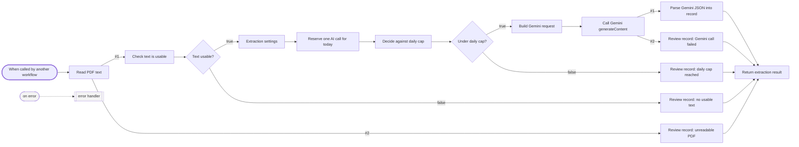

# sub: extract invoice

<!-- n8n-docs:begin (generated by scripts/n8n-docs.js; do not edit between markers) -->

## Diagram

## Purpose

Sub-workflow: PDF text, daily AI-call cap, Gemini structured extraction. Always returns one record.

## Trigger

- `When called by another workflow` (executeWorkflowTrigger): called from another workflow

## Inputs

| Field | Type |
| --- | --- |
| idempotency_key | string |
| message_id | string |
| attachment_id | string |
| filename | string |

## Outputs

Data produced by the terminal node(s): `Return extraction result`

## Error handling

- Error workflow: [error handler](../../error-handler/README.md)
- Nodes with custom error handling: `Call Gemini generateContent` (continueErrorOutput), `Read PDF text` (continueErrorOutput)

## Related workflows

Called by:

- [invoice intake](../../invoice-intake/README.md)

## Nodes

| Node | Type | Credential |
| --- | --- | --- |
| Build Gemini request | code |  |
| Call Gemini generateContent | httpRequest | Gemini API |
| Check text is usable | code |  |
| Decide against daily cap | code |  |
| Extraction settings | set |  |
| Parse Gemini JSON into record | code |  |
| Read PDF text | extractFromFile |  |
| Reserve one AI call for today | postgres | Postgres (local) |
| Return extraction result | set |  |
| Review record: Gemini call failed | code |  |
| Review record: daily cap reached | code |  |
| Review record: no usable text | code |  |
| Review record: unreadable PDF | code |  |
| Text usable? | if |  |
| Under daily cap? | if |  |
| When called by another workflow | executeWorkflowTrigger |  |

<!-- n8n-docs:end -->

## Notes

<!-- Manual notes go here; they survive regeneration. -->
