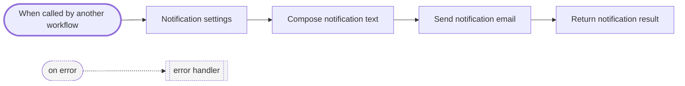

# sub: notify

<!-- n8n-docs:begin (generated by scripts/n8n-docs.js; do not edit between markers) -->

## Diagram

## Purpose

Sub-workflow: send one plain-text notification email about an invoice outcome.

## Trigger

- `When called by another workflow` (executeWorkflowTrigger): called from another workflow

## Inputs

| Field | Type |
| --- | --- |
| status | string |
| invoice_number | string |
| sender | string |
| amount | string |
| currency | string |
| invoice_id | string |
| filename | string |
| issues | array |

## Outputs

Data produced by the terminal node(s): `Return notification result`

## Error handling

- Error workflow: [error handler](../../error-handler/README.md)

## Related workflows

Called by:

- [invoice intake](../../invoice-intake/README.md)

## Nodes

| Node | Type | Credential |
| --- | --- | --- |
| Compose notification text | code |  |
| Notification settings | set |  |
| Return notification result | set |  |
| Send notification email | gmail | Gmail (secondary account) |
| When called by another workflow | executeWorkflowTrigger |  |

<!-- n8n-docs:end -->

## Notes

<!-- Manual notes go here; they survive regeneration. -->
