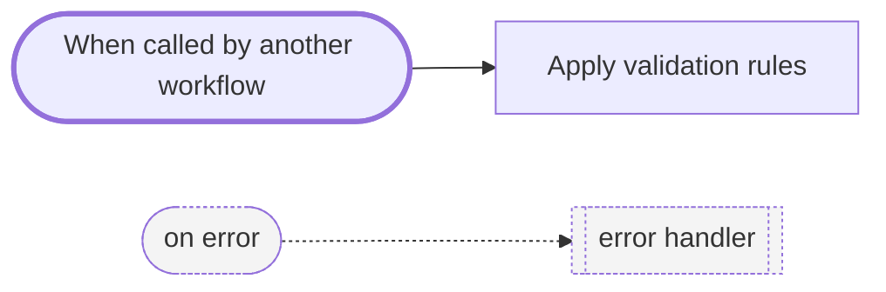

# sub: validate invoice

<!-- n8n-docs:begin (generated by scripts/n8n-docs.js; do not edit between markers) -->

## Diagram

## Purpose

Sub-workflow: apply the invoice validation rules. No external calls.

## Trigger

- `When called by another workflow` (executeWorkflowTrigger): called from another workflow

## Inputs

| Field | Type |
| --- | --- |
| invoice | object |

## Outputs

Data produced by the terminal node(s): `Apply validation rules`

## Error handling

- Error workflow: [error handler](../../error-handler/README.md)

## Related workflows

Called by:

- [invoice intake](../../invoice-intake/README.md)

## Nodes

| Node | Type | Credential |
| --- | --- | --- |
| Apply validation rules | code |  |
| When called by another workflow | executeWorkflowTrigger |  |

<!-- n8n-docs:end -->

## Notes

<!-- Manual notes go here; they survive regeneration. -->
